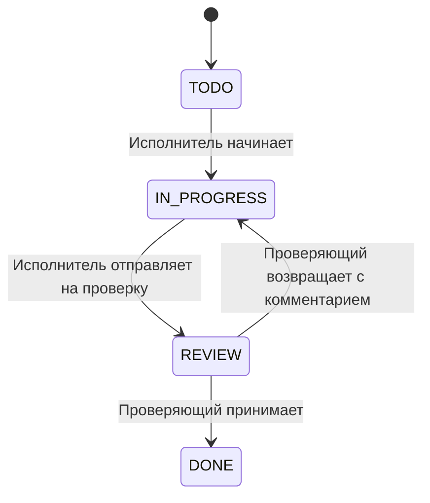

# Team Task Manager

Сервис управления командными задачами с обязательной проверкой результата. Развитие тестового задания: от CRUD API к проектам с разграничением доступа, процессом согласования и аудитом.

Владелец проекта добавляет участников и назначает исполнителя и проверяющего. Исполнитель выполняет задачу и отправляет её на проверку. Проверяющий принимает результат или возвращает задачу с обязательным комментарием.



## Возможности

- Регистрация, HTTP Basic, хеширование паролей BCrypt.
- Несколько проектов на пользователя, роли OWNER и MEMBER внутри проекта.
- Изоляция проектов: участник видит только свои проекты, их задачи, комментарии и историю.
- Разные исполнитель и проверяющий; проверка принадлежности обоих к проекту.
- Контролируемые переходы статусов; редактирование содержимого во время REVIEW и после DONE запрещено.
- Комментарии и история: автор действия, время, изменения содержимого, назначений и статуса.
- Защита от потери изменений через optimistic locking: устаревшая версия получает `409 Conflict`.
- Постраничная выдача задач, комментариев и событий; фильтр задач по статусу.
- Flyway, PostgreSQL, локальная H2, Swagger UI, Docker Compose и GitHub Actions.

## Быстрый запуск

Нужен **JDK 17+** (в CI и Docker используется JDK 21). Maven скачивается через wrapper.

```bash
./mvnw spring-boot:run
```

По умолчанию приложение использует файловую H2 в `data/team-taskdb`. Старый файл `data/taskdb` от исходного задания не используется и не изменяется.

Swagger: http://localhost:8080/swagger-ui.html. Зарегистрируйте пользователя через `POST /api/auth/register`, затем нажмите **Authorize** и введите логин и пароль. Логин: 3–40 символов `a-z`, `0-9`, `_`; пароль: минимум 10 символов, максимум 72 байта UTF-8.

Полный демонстрационный сценарий (нужен Python 3, сторонние библиотеки не требуются):

```bash
python3 scripts/demo.py
```

Скрипт создаёт трёх пользователей с уникальными именами, проект и задачу, проходит цикл с возвратом на доработку и выводит данные для входа в Swagger. Каждый запуск создаёт новый пример.

## Запуск с PostgreSQL

```bash
cp .env.example .env
docker compose up --build
```

API доступен на http://localhost:8080. PostgreSQL хранит данные в Docker volume и не публикует порт на хост. Остановка: `docker compose down`. Конфигурация `.env` предназначена для локальной разработки и исключена из Git. При размещении на сервере настройте собственные учётные данные и HTTPS.

Для внешней БД задайте `DB_URL`, `DB_USERNAME`, `DB_PASSWORD`. Flyway создаёт схему, Hibernate проверяет её через `ddl-auto=validate`.

## API

Все операции, кроме регистрации и просмотра OpenAPI, требуют HTTP Basic.

| Метод | Путь | Назначение |
|---|---|---|
| POST | `/api/auth/register` | Регистрация |
| GET | `/api/auth/me` | Текущий пользователь |
| POST / GET | `/api/projects` | Создать проект / получить свои проекты |
| POST / GET | `/api/projects/{id}/members` | Добавить участника / посмотреть участников |
| POST / GET | `/api/projects/{id}/tasks` | Создать задачу / список с `status`, `page`, `size` |
| GET / PATCH | `/api/tasks/{id}` | Прочитать / изменить заголовок и описание |
| PUT | `/api/tasks/{id}/assignment` | Заменить исполнителя и проверяющего |
| POST | `/api/tasks/{id}/transitions` | Перевести задачу в следующий статус |
| POST / GET | `/api/tasks/{id}/comments` | Добавить / прочитать комментарии |
| GET | `/api/tasks/{id}/history` | История изменений |

PATCH, назначение и переход статуса требуют текущий `version` из ответа задачи. После изменения используйте новую версию из ответа. При `409` перечитайте задачу и согласуйте изменения. Пример тела перехода:

```json
{"version": 2, "status": "IN_PROGRESS", "comment": "Добавь тесты прав доступа"}
```

Страницы имеют поля `items`, `page`, `size`, `totalElements`, `totalPages`. Нумерация с нуля, размер 1–100, сортировка по ID от новых записей к старым. В PATCH `null` означает «не менять»; очистить описание можно пустой строкой. PUT назначения заменяет оба поля: отсутствующий или `null` исполнитель/проверяющий снимает соответствующее назначение.

## Правила доступа

| Действие | Кто может выполнить |
|---|---|
| Читать задачи, комментарии и историю | Участник проекта |
| Создать неназначенную задачу, написать комментарий | Участник проекта |
| Добавить участника, назначить исполнителя и проверяющего | Владелец проекта |
| Изменить заголовок и описание в TODO / IN_PROGRESS | Автор задачи или владелец проекта |
| TODO → IN_PROGRESS, IN_PROGRESS → REVIEW | Назначенный исполнитель |
| REVIEW → DONE, REVIEW → IN_PROGRESS | Назначенный проверяющий |

Владелец не обходит процесс проверки: принять задачу он может, только если назначен её проверяющим. Исполнитель не может проверить собственную работу. Перед отправкой на проверку нужен проверяющий. При возврате обязателен непустой комментарий. Изменять назначения в REVIEW / DONE нельзя. Для пользователя вне проекта возвращается `404`, чтобы не раскрывать чужие данные.

## Проверки

```bash
./mvnw verify
```

Интеграционные тесты проходят через HTTP-слой MockMvc с настоящей аутентификацией, Flyway и БД: изоляция проектов, роли, полный цикл ревью, атомарность возврата с комментарием, устаревшие версии, одновременные изменения, валидация и пагинация. В GitHub Actions один набор запускается на H2 и PostgreSQL.

Запуск того же набора на отдельной тестовой PostgreSQL:

```bash
TEST_DB_URL=jdbc:postgresql://localhost:5432/taskmanager_test \
TEST_DB_USERNAME=taskmanager TEST_DB_PASSWORD=test-password ./mvnw verify
```

Тесты создают данные: используйте отдельную тестовую БД.

## Архитектура и решения

Один Spring Boot-сервис: контроллеры → транзакционные сервисы → JPA-репозитории. DTO отделены от сущностей; JPA-сущности и хеши паролей не сериализуются в API. PostgreSQL — основная БД для Docker, H2 — быстрый локальный режим. Время событий хранится как `Instant`.

Смена статуса, комментарий к возврату и событие истории сохраняются в одной транзакции. Проверка ожидаемой версии даёт понятную ошибку при работе с устаревшим ответом, а JPA `@Version` защищает от реальных одновременных записей в БД. История доступна только для чтения; удаление задач через API не предусмотрено.

HTTP Basic выбран для небольшой первой версии без отдельного сервера авторизации и жизненного цикла токенов. Клиент передаёт заголовок Authorization на каждый запрос; сервер не создаёт сессии и не использует cookie для аутентификации. Для публичного развёртывания API требуется HTTPS.

Подробнее о модели и границах версии: [docs/architecture.md](docs/architecture.md). Исходное тестовое задание сохранено в [docs/original-assignment](docs/original-assignment); оно не участвует в сборке новой версии. Автоматического переноса старых задач в проекты нет.

## Дальнейшее развитие

- Уведомления внутри приложения и transactional outbox для надёжной доставки.
- Приглашения, выход из команды и передача владения проектом.
- Дедлайны, приоритеты, поиск и зависимости задач с проверкой циклов.
- Веб-интерфейс канбан-доски.

Текущая версия — backend API. Интерфейс пользователя представлен Swagger; уведомления, восстановление пароля и ограничение частоты регистрации пока не реализованы.
