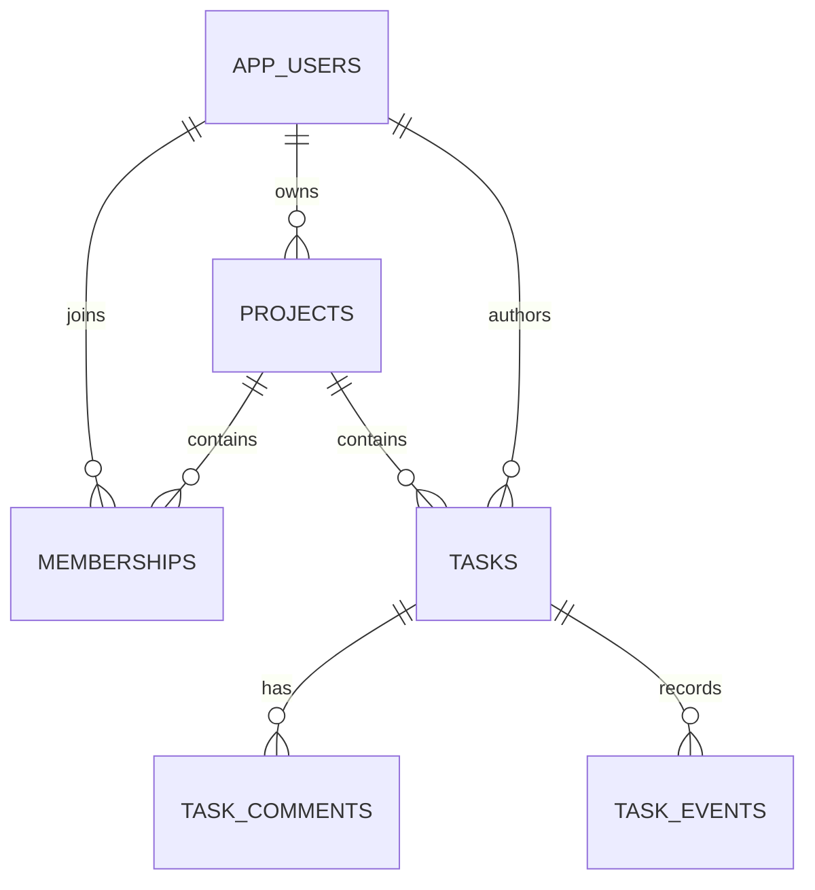

# Архитектура

## Модель данных

Задача дополнительно ссылается на исполнителя и проверяющего. Принадлежность их к проекту проверяет сервис. Пара `(project_id, user_id)` уникальна в таблице участников. Владелец проекта автоматически становится участником; роль OWNER вычисляется по владельцу проекта. Это исключает создание нескольких владельцев через добавление участников.

Схема содержит внешние ключи и индексы для выборок по проекту, статусу и задаче. Схема управляется Flyway, автоматическое изменение Hibernate отключено. Следующие изменения схемы оформляются новой миграцией.

## Согласованность

Все изменения задачи и события аудита выполняются в одной транзакции. При конфликте версий откатываются и задача, и события. Добавление комментария не меняет версию задачи: комментарии независимы от редактирования карточки.

Проверка `version` из запроса выявляет устаревшие данные до изменения сущности; Hibernate `@Version` выявляет гонку после чтения. Клиент получает `409` и должен перечитать задачу. Проверка переходов статуса выполняется внутри того же сервиса и транзакции.

## Границы первой версии

- Добавление в проект выполняется владельцем по имени уже зарегистрированного пользователя. Приглашений и подтверждения участия пока нет.
- Владелец управляет назначениями, но не может принять работу вместо назначенного проверяющего.
- Нет удаления пользователей, участников, проектов и задач. Сохранение истории не требует каскадного удаления или архивирования.
- DONE является конечным статусом. Для новых требований создаётся отдельная задача.
- Нет внешней отправки сообщений. В будущем событие для доставки можно сохранять в outbox вместе с изменением задачи.
- Весь сервис развёртывается одним процессом. Выделение микросервисов не требуется для текущих сценариев.

## Проверяемые свойства

Набор интеграционных тестов проверяет поведение публичного API и реальную работу БД. Отдельный тест отправляет два изменения одной версии одновременно: успешно проходит одно, второе получает конфликт, а в журнале появляется только одно изменение. CI проверяет один набор на H2 и PostgreSQL, чтобы выявлять различия миграций и SQL.
